# NEON DASH: Mobile Game Menu System

- **Course:** ITU CS-464, Lab 07
- **Roll number:** BSSE23081
- **Demo video:** [Watch on Google Drive](https://drive.google.com/file/d/1OSt1vBUK8aSYmmndLfBc4G98_DJvLPa6/view?usp=sharing)

NEON DASH is a portrait-mode (1080 x 1920) neon endless-runner menu system built in Unity UGUI + TextMeshPro. It has **10 connected screens** on a single Canvas. Every screen has a way forward and a way back, and all motion is driven by small hand-written tweens (coroutines with explicit ease functions).

The visual direction is taken from **Neon Runner** (see [Credits and references](#credits-and-references)).

---

## Contents

1. [Setup and run instructions](#setup-and-run-instructions)
2. [Navigation map](#navigation-map)
3. [Design system](#design-system)
4. [Motion system](#motion-system)
5. [Screen 1 - Title](#screen-1---title)
6. [Screen 2 - Main Menu](#screen-2---main-menu)
7. [Screen 3 - Mode Select](#screen-3---mode-select)
8. [Screen 4 - Loadout](#screen-4---loadout)
9. [Screen 5 - Shop](#screen-5---shop)
10. [Screen 6 - Leaderboard](#screen-6---leaderboard)
11. [Screen 7 - Achievements](#screen-7---achievements)
12. [Screen 8 - Settings (with Credits popup)](#screen-8---settings-with-credits-popup)
13. [Screen 9 - Pause](#screen-9---pause)
14. [Screen 10 - Results](#screen-10---results)
15. [Supporting screen - Run placeholder](#supporting-screen---run-placeholder)
16. [Credits and references](#credits-and-references)

---

## Setup and run instructions

1. Clone the repository and open the folder in **Unity 6000.3.24f1 LTS** via *Unity Hub > Add > Add project from disk*. (`Library/`, `Temp/`, `Logs/` and `obj/` are not committed; Unity regenerates them on first open.)
2. Make sure **TextMeshPro** is installed (*Window > Package Manager > TextMeshPro*). If prompted, click **Import TMP Essentials**.
3. Open the scene `Assets/Scenes/SampleScene.unity`.
4. If the scene has no `NeonCanvas` object, run **Tools > Build Neon UI** from the menu bar. This editor script generates the whole 10-screen UI, wires up every button, and adds an EventSystem if one is missing.
5. In the **Game** view, choose a portrait resolution of **1080 x 1920**.
6. Press **Play**. Tap/click anywhere on the Title screen to start.

---

## Navigation map

| From | To | How |
|---|---|---|
| Title | Main Menu | Tap anywhere (full-screen button) |
| Main Menu | Mode Select, Shop, Leaderboard, Achievements, Settings | Buttons |
| Mode Select | Loadout | **Endless** or **Time Trial** cards (Zen is locked) |
| Loadout | Shop, Run | **SHOP** and **START RUN** buttons |
| Shop / Leaderboard / Achievements / Settings / Mode Select / Loadout | previous screen | `<` back button (history stack) |
| Run (placeholder) | Pause, Results | **II** and **DIE (TEST)** |
| Pause | Run, Run (fresh), Settings, Main Menu | **RESUME** / **RESTART** / **SETTINGS** / **MAIN MENU** |
| Results | Run, Main Menu | **RETRY** / **WATCH AD: CONTINUE** / **MAIN MENU** |

---

## Design system

### Palette

| Token | Hex | Used for |
|---|---|---|
| `BG` | `#05050F` | Near-black background, the dark base that makes neon glow |
| `Cyan` | `#19E6FF` | Primary: titles, primary actions (PLAY, RETRY, START RUN), selected state, player data |
| `Pink` | `#FF2D8A` | Secondary: commerce and exit actions (SHOP, MAIN MENU), Time Trial |
| `Gold` | `#FFC933` | Currency and rewards (coins, leaderboard, ad rewards, credits) |
| `Purple` | `#9B5CFF` | Utility (settings, items) |
| `Green` | `#2EE89A` | Tertiary accent (Emerald skin) |
| `Red` | `#FF3358` | Danger / failure (RUN OVER, DIE) |
| `White` | `#EDEDF7` | Body and primary text |
| `Grey` | `#9A9AB0` | Secondary text, disabled content |
| `Dim` | `#3A3A52` | Inactive borders, unselected tabs, locked cards |

Contrast against `BG` (WCAG relative-luminance ratio, computed from the hex values): White 17.4:1, Cyan 13.3:1, Gold 13.2:1, Green 12.7:1, Grey 7.4:1, Pink 5.8:1, Red 5.7:1, Purple 5.2:1. All text colours are above 4.5:1. `Dim` is only used for decorative borders and inactive backgrounds, never for text.

### Shared principles

- **Bordered neon boxes.** Every container is a bright 3-4 px border over a dark fill tinted 6-18% toward its accent colour. This gives a consistent "neon sign" look and a clear affordance, since anything with a coloured border can be tapped.
- **Hierarchy through size.** Titles are 110-130 pt, primary buttons 60+ pt, secondary buttons 38-52 pt, captions 22-36 pt. The most important action (PLAY, RETRY, START RUN) is always the largest button on its screen.
- **Touch targets.** Buttons are 110-180 px tall on the 1080 x 1920 reference canvas (about 6-9% of the screen height). The back button is 140 x 140. These are comfortably above the usual 44-48 dp minimum.
- **Responsive anchors.** The Canvas uses *Scale With Screen Size* (1080 x 1920, match 0.5). Headers and the coin counter are anchored to the top-left and top-right corners, and content is anchored to the centre, so layouts survive different phone aspect ratios.
- **Not colour-only.** State is also carried by text and shape: `ON` / `OFF` labels beside toggles, `IN USE` / `BUY` button labels, `LOCKED` text on Zen, `?` icons on locked achievements, and a bold label plus underline bar on the selected tab.

---

## Motion system

All tweens are written as small coroutines using `Time.unscaledDeltaTime`, so they still run when the game is paused (`Time.timeScale = 0`).

| Interaction | Script | Duration | Easing | Why |
|---|---|---|---|---|
| Screen transition | `ScreenManager` | 0.35 s | `AnimationCurve.EaseInOut` | Cross-fade plus a 120 px horizontal slide. Forward navigation slides in from the right and Back from the left, so the motion tells the player where they are in the hierarchy. Ease-in-out avoids a robotic linear start and stop. |
| Button press | `ButtonFeedback` | 0.08 s | Ease-out cubic, `1 - (1-t)^3` | Scale to 0.94 immediately. A fast ease-out feels like a physical press and gives instant feedback. |
| Button release | `ButtonFeedback` | 0.20 s | Ease-out-back (overshoot) | Springs back past 1.0 and settles, so the button visibly bounces back and the player can tell the tap registered. |
| Logo / "TAP TO START" pulse | `Pulse` | Loop (sine), 1.6 and 3.0 speed | Sine | The slow logo breathes (alpha 0.75-1, scale +3%). The faster prompt blinks (alpha 0.3-1), so it reads as the thing to tap. |
| Loadout value change | `CycleOption` | 0.25 s | Sine bump with decay: `1 + 0.25·sin(πt)·(1-t)` | The changed text pops, which confirms the cycle step and draws attention to the new value. |
| Settings toggle | `ToggleSwitch` | 0.20 s | Smoothstep, `t²(3-2t)` | The knob slides from one end to the other, so the state change is visible as motion, not just a swap. |

Not animated: tab switching in the Shop and the Credits popup open/close are instant (`SetActive`). Tab state is communicated by border, bold text and underline instead.

---

## Screen 1 - Title

**Purpose:** The first impression. It establishes the brand and shows the one action available: tap to start.

| Colour | Annotated | Greyscale |
|---|---|---|
| 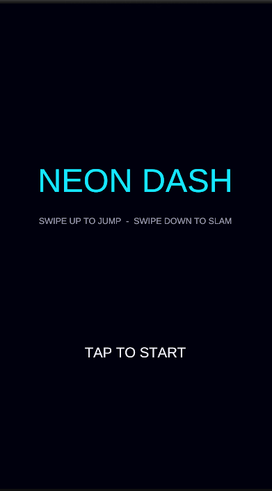 | 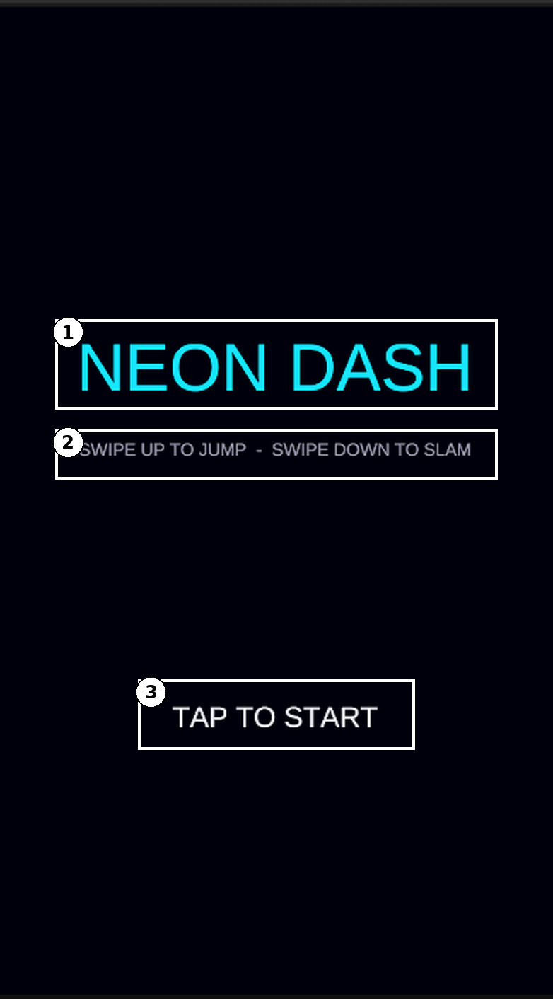 | 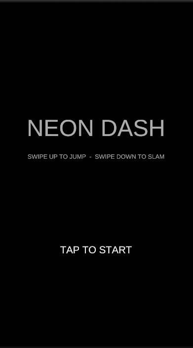 |

**Annotations**
1. **Logo.** The largest element (130 pt) in the primary Cyan, which sets the hierarchy immediately. It pulses gently (`Pulse`).
2. **Controls hint.** Small grey caption, clearly subordinate to the logo. It teaches the gameplay controls before the first run.
3. **TAP TO START.** White rather than Cyan, so it differs from the logo. It blinks faster than the logo to work as the call to action.

**Principles and techniques:** visual hierarchy by size and value, generous empty space (focal point), single obvious affordance, the whole screen is the touch target (accessibility), centred layout.

**Tweens / ease:** `Pulse` sine loop on logo (alpha + scale) and prompt (alpha). Leaving the screen uses the 0.35 s ease-in-out fade + slide.

**Greyscale check:** White prompt, Cyan logo and Grey caption stay clearly distinct, because they differ in size and lightness (Cyan Y = 0.64, White Y = 0.85, Grey Y = 0.33). Fine as is.

---

## Screen 2 - Main Menu

**Purpose:** The hub. It gives access to every other part of the game and shows the player's progress at a glance.

| Colour | Annotated | Greyscale |
|---|---|---|
| 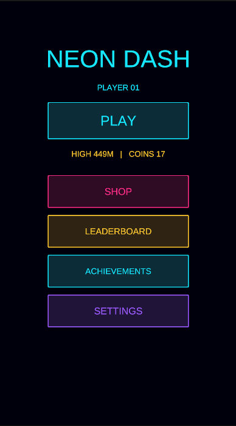 | 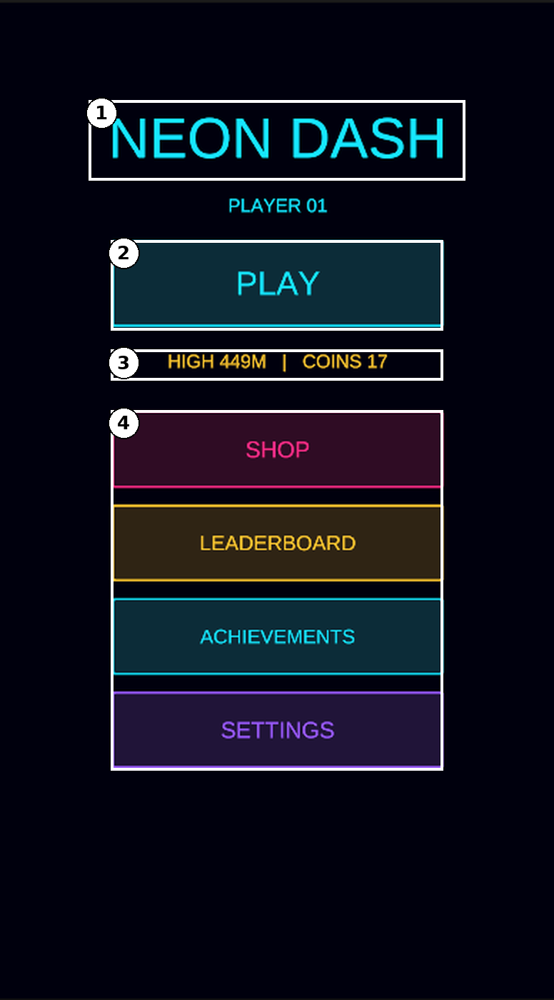 | 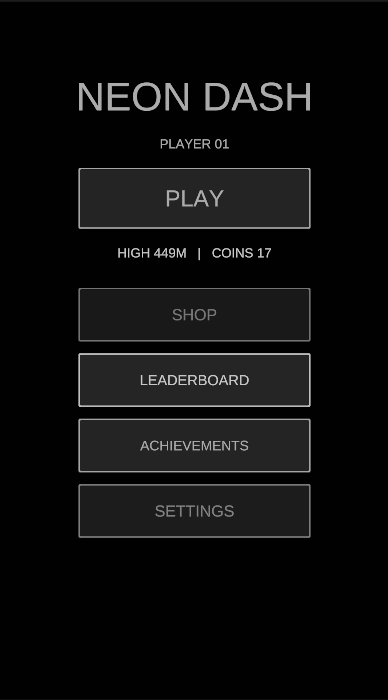 |

**Annotations**
1. **Title and player name** at the top, as in the reference game.
2. **PLAY.** Largest button (170 px tall, 64 pt) in Cyan: the primary action.
3. **Progress line** (HIGH / COINS) in Gold, the currency colour, placed between the primary action and the secondary ones.
4. **Secondary buttons** (SHOP, LEADERBOARD, ACHIEVEMENTS, SETTINGS): equal width and spacing, smaller (150 px). Each has its own accent colour, so categories are recognisable.

**Principles and techniques:** hierarchy (one big primary + a uniform secondary group), grouping by proximity and equal spacing, colour coding by function, centre alignment, large touch targets.

**Tweens / ease:** `ButtonFeedback` on every button (0.94 scale, ease-out 0.08 s, ease-out-back 0.2 s). Screen transition slides in from the right.

**Greyscale check:** PLAY stays dominant by size. The four secondary buttons become similar greys, but each is identified by its text label and border, and they are not distinguished by hue alone. No change needed.

---

## Screen 3 - Mode Select

**Purpose:** The player picks a game mode before entering the loadout.

| Colour | Annotated | Greyscale |
|---|---|---|
| 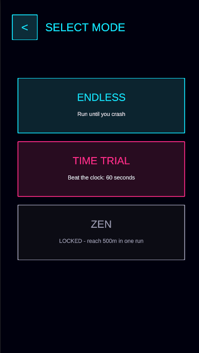 | 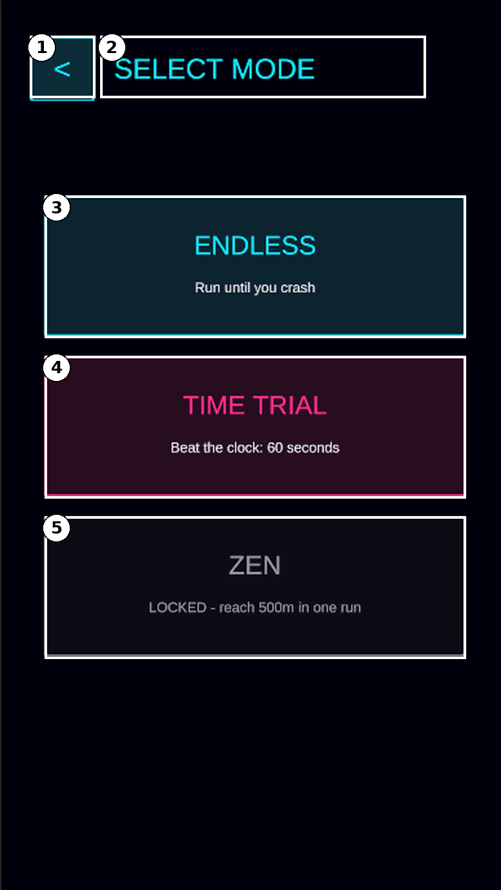 | 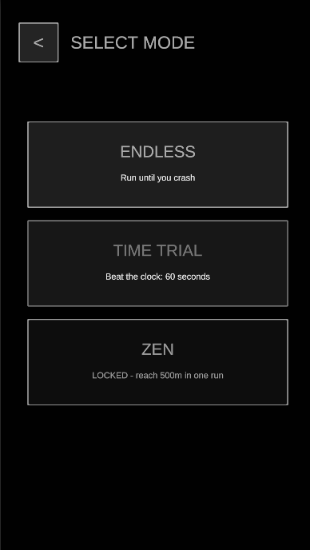 |

**Annotations**
1. **Back button** in the top-left, consistent on every sub-screen.
2. **Screen title**, left-aligned next to the back button.
3. **ENDLESS card.** Cyan, with a title and a one-line description.
4. **TIME TRIAL card.** Pink, so the two modes are visually distinct.
5. **ZEN card (locked).** Desaturated Grey, a dim border, no press animation, a non-interactable button, and a text reason (*LOCKED - reach 500m in one run*).

**Principles and techniques:** consistent header component, cards with title + description (progressive information), disabled state clearly different from enabled (low saturation, lower fill tint, no feedback), a stated unlock condition (goal gradient), even vertical rhythm.

**Tweens / ease:** `ButtonFeedback` on the two active cards only. The locked card deliberately does not respond to touch. Back slides in from the left.

**Greyscale check:** The locked card is distinguishable from the active ones by its much darker fill, dimmer text and absent bright border, and also by its `LOCKED` label. Nothing to fix.

---

## Screen 4 - Loadout

**Purpose:** The player customises the run (skin, trail, power-up item) before starting, with shortcuts to the Shop and START RUN.

| Colour | Annotated | Greyscale |
|---|---|---|
| 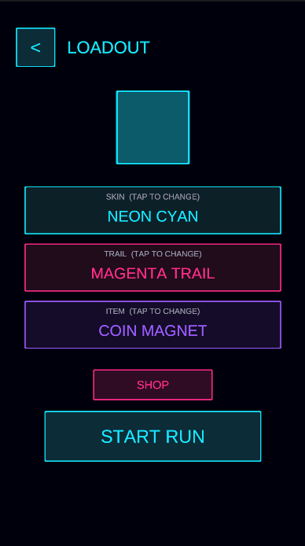 | 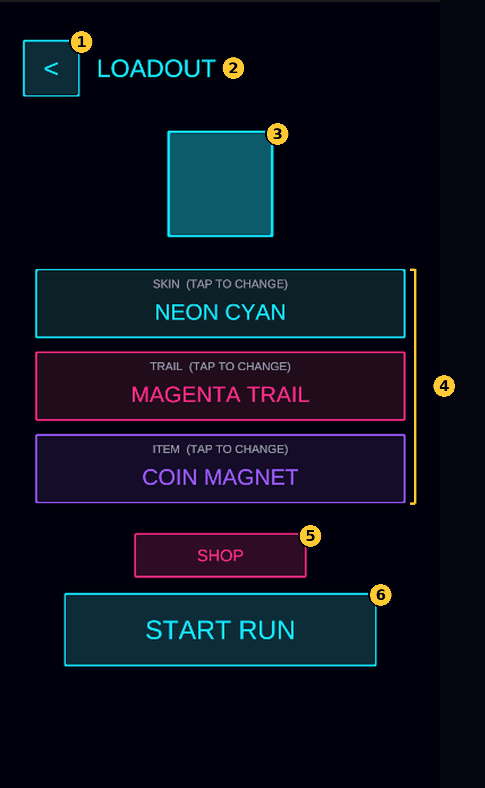 | 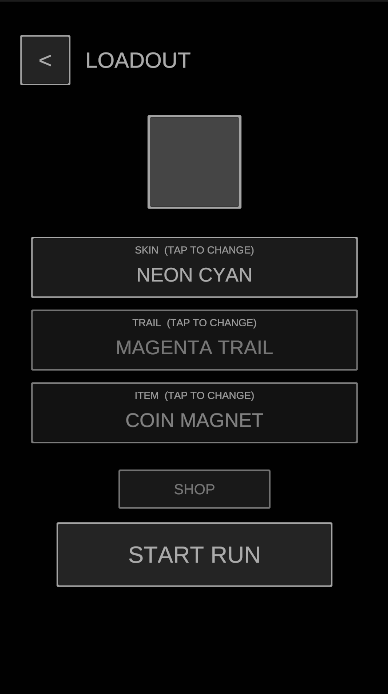 |

This capture has a trail and an item selected, so all three accent colours are visible.

**Annotations**
1. **Back button**, top-left, same as on the other sub-screens.
2. **Screen title**, next to the back button.
3. **Skin preview** (260 px square). Its colour follows the selected skin.
4. **Cycle cards**: SKIN (Cyan), TRAIL (Pink), ITEM (Purple). Tap a card to move to the next option. Each says *(TAP TO CHANGE)* so the affordance is explicit.
5. **SHOP** (Pink, secondary) for buying more options.
6. **START RUN** (Cyan, 180 px tall, 64 pt), the primary action and the largest button on the screen.

**Principles and techniques:** preview-then-choose (immediate visual result), explicit affordance text on cards, single dominant primary action at the bottom within thumb reach, same accent colour for the same concept as the Shop (Cyan skin, Pink trail).

**Tweens / ease:** `CycleOption` pop (0.25 s, sine bump with decay) on the changed value. The preview tint changes at the same moment. `ButtonFeedback` on cards and buttons.

**Greyscale check:** START RUN stays dominant by size. The three cards are told apart by their SKIN / TRAIL / ITEM labels rather than by hue. The Pink TRAIL card and SHOP button turn into the darkest greys because Pink has the lowest luminance of the three, but their text is still readable and the borders are still visible. No change needed.

---

## Screen 5 - Shop

**Purpose:** Spend coins on skins, trails and items, and earn coins by watching an ad. Three tabs keep a lot of content on one screen.

**Skins tab**

| Colour | Annotated | Greyscale |
|---|---|---|
| 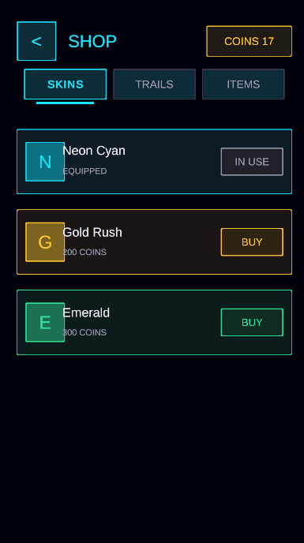 | 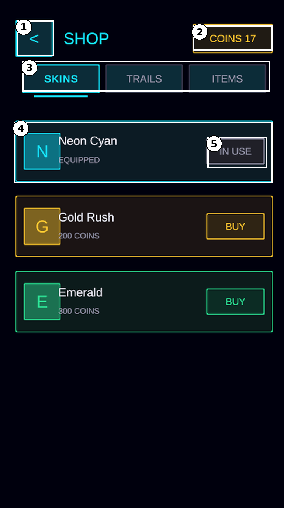 | 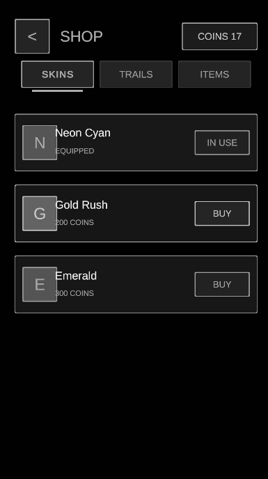 |

**Trails tab / Items tab** (colour, then greyscale)

| Trails colour | Trails greyscale | Items colour | Items greyscale |
|---|---|---|---|
| 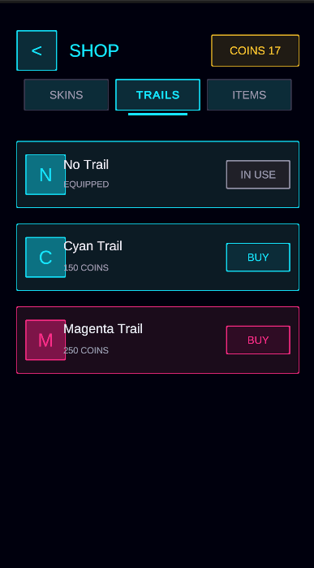 | 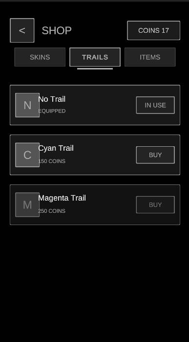 | 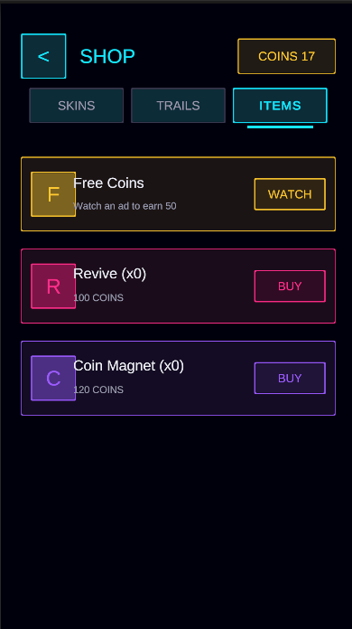 | 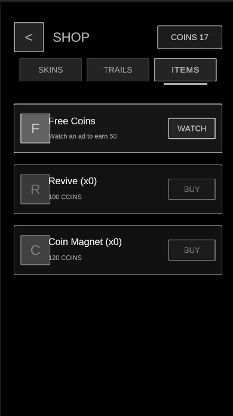 |

**Annotations**
1. **Back button**, same position as everywhere else.
2. **Coin balance**, anchored top-right in Gold, always visible while shopping.
3. **Tabs.** The selected tab has three cues: a bright Cyan border, bold text and an underline bar. Unselected tabs are Dim with grey text.
4. **Item row.** Icon (initial letter in the item's colour), name, price/status, and an action button. Each row has the colour of its item.
5. **State button.** `IN USE` is greyed and non-interactable, whereas `BUY` / `WATCH` have bright borders and respond to touch.

**Principles and techniques:** grouping with tabs (chunking), a consistent row template (similarity), redundant selected-state cues (border + bold + underline, not colour only), a persistent currency display (anchored to the corner), disabled state for the equipped item, reuse of the reference game's tab + row structure.

**Tweens / ease:** `ButtonFeedback` on tabs and buy buttons. Tab content swaps instantly (see the motion note above), and the underline moves with the selected tab.

**Greyscale check:** The selected tab still reads clearly because of its bright border, bold text and underline. `IN USE` is distinguishable from `BUY` by its dim border and fill. Fine as is.

---

## Screen 6 - Leaderboard

**Purpose:** Shows the player's rank compared with others, to motivate replay.

| Colour | Annotated | Greyscale |
|---|---|---|
| 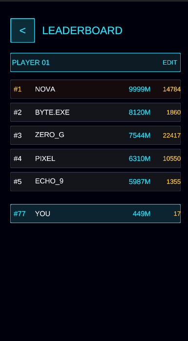 | 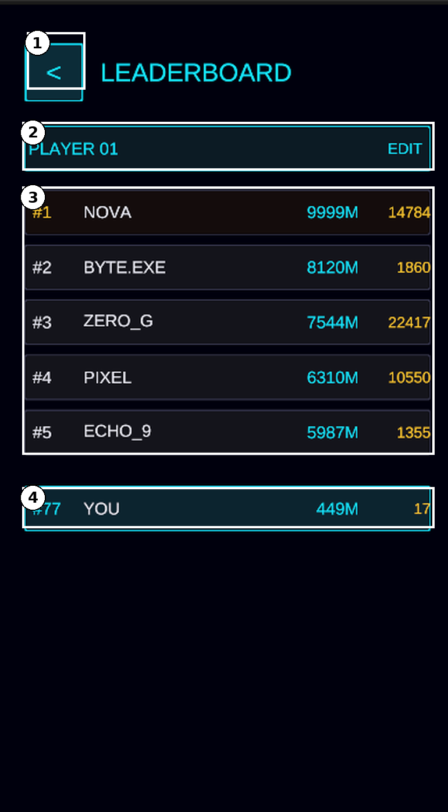 | 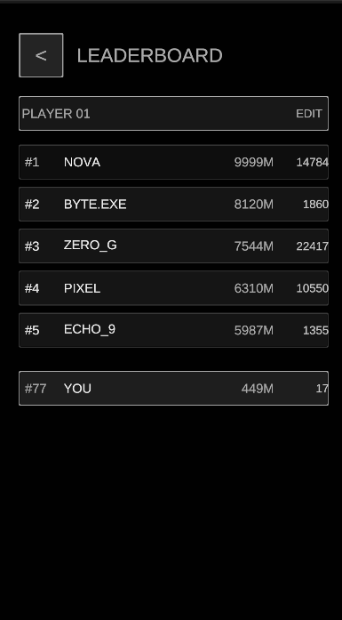 |

**Annotations**
1. **Back button.**
2. **Player banner.** A Cyan-bordered row with the player name and an **EDIT** affordance.
3. **Top-5 table.** Four aligned columns (rank, name, distance, coins) with fixed widths, so numbers line up. Rank 1 is Gold, the rest White. Distance is Cyan, coins are Gold.
4. **YOU row.** Separated from the top 5 by a gap, with a Cyan border and a stronger fill, so the player finds themselves immediately even at rank #77.

**Principles and techniques:** alignment (columns), colour coding by data type (distance vs. currency), highlighting the player's own row (von Restorff / isolation effect), left-aligned text and right-aligned numbers for scanning.

**Tweens / ease:** back/forward screen slide only. This screen is a static information view, so extra motion would be decoration.

**Greyscale check:** The YOU row is separated by its border and position (not just hue). Rank 1's Gold becomes a bright grey, and the leading `#1` is still readable. No change needed.

---

## Screen 7 - Achievements

**Purpose:** Shows progress and long-term goals, split into *Completed* and *Locked*.

| Colour | Annotated | Greyscale |
|---|---|---|
| 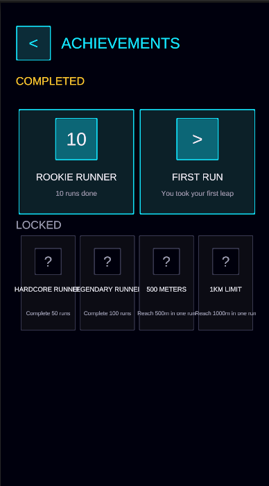 | 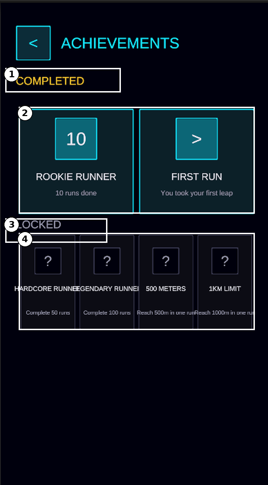 | 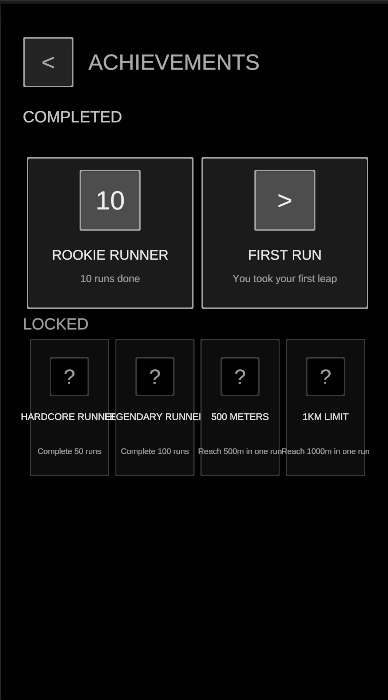 |

**Annotations**
1. **COMPLETED** section label in Gold (reward).
2. **Completed cards.** Large (460 x 420), Cyan bordered, with a bright icon, a title and a description.
3. **LOCKED** section label in Grey (inactive).
4. **Locked cards.** Smaller and dimmer, Dim borders, `?` icons, with the unlock requirement in the description (e.g. *Reach 500m in one run*).

**Principles and techniques:** grouping by state with clear section headers, state expressed by size, brightness *and* icon (`?`), so it is not colour-only, goal visibility (the requirement is always shown), inspired by the reference game's Completed / Locked split.

**Tweens / ease:** screen slide only.

**Greyscale check:** Completed and locked cards remain clearly different (bright icon + border vs. dim). No change needed.

---

## Screen 8 - Settings (with Credits popup)

**Purpose:** Toggle sound, music and vibration, and open the credits.

| Colour | Annotated | Greyscale |
|---|---|---|
| 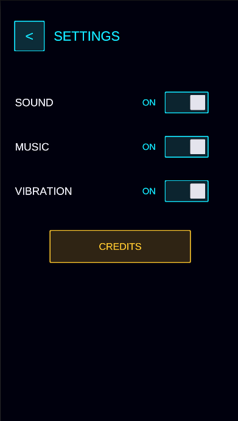 | 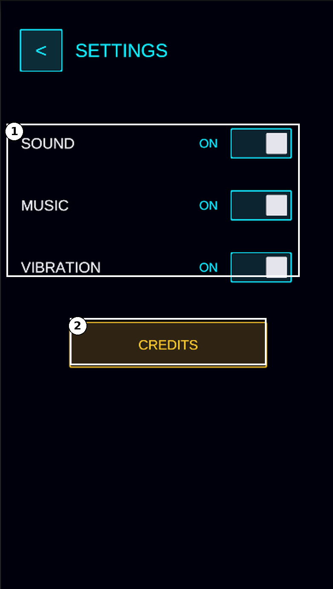 | 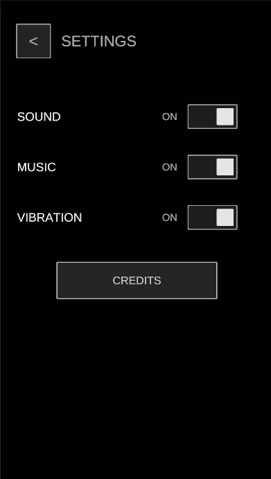 |

**Credits popup**

| Colour | Annotated | Greyscale |
|---|---|---|
| 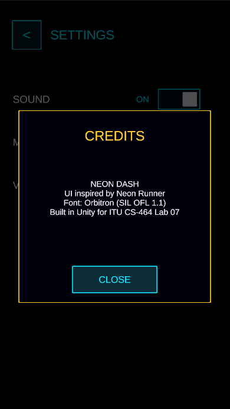 | 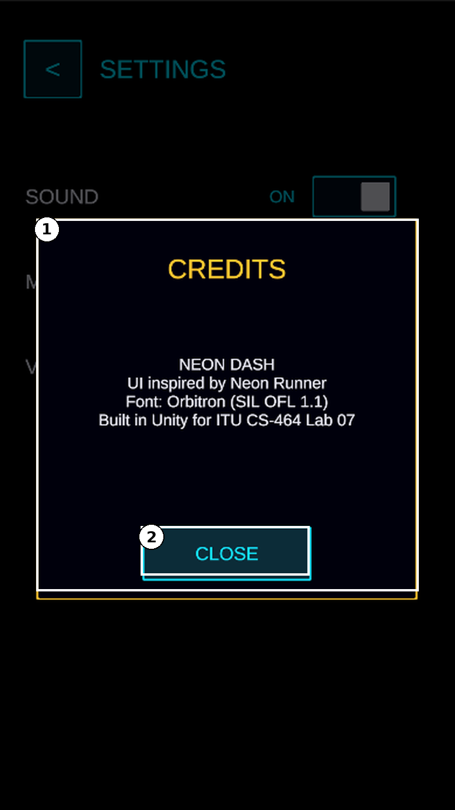 | 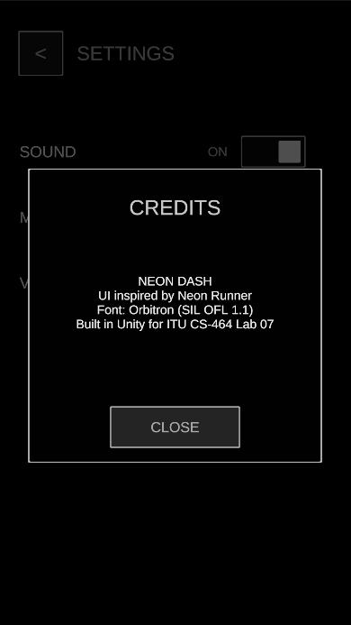 |

**Annotations (settings)**
1. **Toggle rows.** Label on the left, an `ON` / `OFF` text in the middle and a switch on the right. The knob position, track colour *and* text all show the state.
2. **CREDITS button** (Gold) opens the popup.

**Annotations (credits popup)**
1. **Modal card.** A 90%-opaque black overlay dims and blocks the screen behind it, so the focus is only on the card.
2. **CLOSE button.** One clear way out (so there is no dead end), in the primary Cyan.

**Principles and techniques:** the switch is a familiar mobile metaphor (affordance), redundant state cues (position + text + colour), modal overlay for focus, consistent button style, right-aligned controls in a thumb-friendly column.

**Tweens / ease:** `ToggleSwitch`: 0.2 s smoothstep knob slide. `ButtonFeedback` on CREDITS and CLOSE. The popup appears instantly.

**Greyscale check:** `ON` and `OFF` are distinguishable by text and knob position, and not only by Cyan vs. Grey. Fine as is.

---

## Screen 9 - Pause

**Purpose:** Interrupt the run and let the player resume, restart, change settings, or leave.

| Colour | Annotated | Greyscale |
|---|---|---|
| 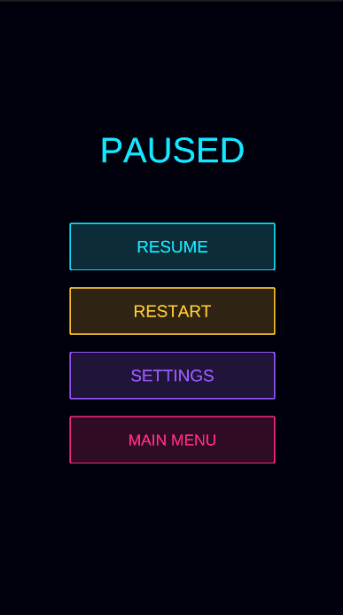 | 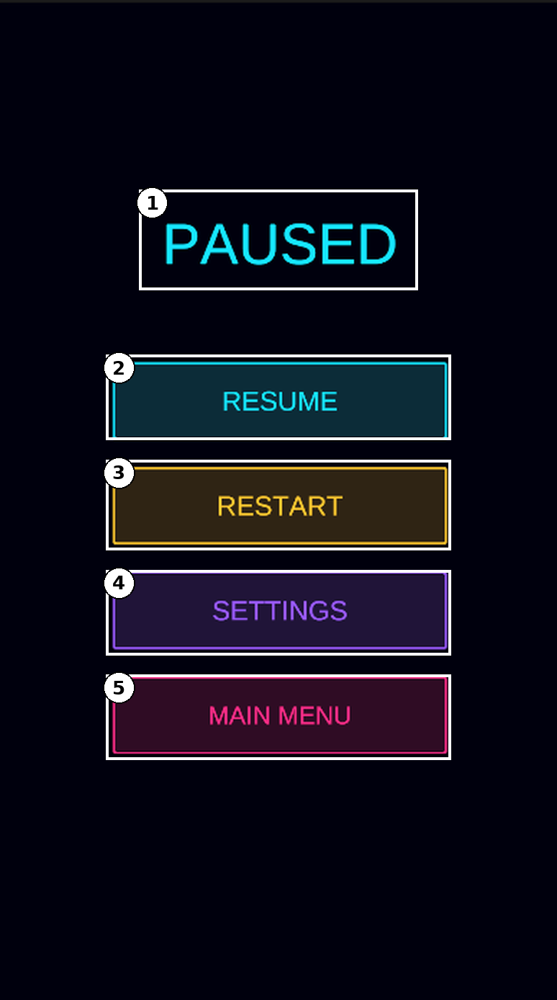 | 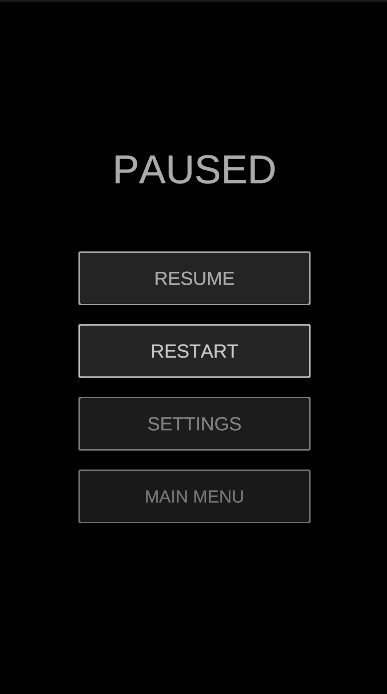 |

**Annotations**
1. **PAUSED.** Large Cyan title (110 pt) that states the current state, and is the biggest element.
2. **RESUME.** Cyan, in the first position, the safest and most common action. It calls `Back()`, so it returns to the run exactly as it was left.
3. **RESTART.** Gold, calls `GoRoot("Run")` to start a fresh run.
4. **SETTINGS.** Purple, calls `Go("Settings")`. Back from Settings returns here through the history stack.
5. **MAIN MENU.** Pink, in the last position, the exit action, clearly separated in colour from the "keep playing" actions. It calls `GoRoot("MainMenu")`.

**Principles and techniques:** a single centred column with identical button width, height (640 x 150) and even spacing (grouping and rhythm), ordered from least to most disruptive (Resume, Restart, Settings, Main Menu), one accent colour per function (the same colours as on the Main Menu and Results screens, for consistency), large touch targets, and a dark, sparse layout so the player can focus on the choices.

**Tweens / ease:** `ButtonFeedback` on all four buttons (0.94 scale, ease-out cubic 0.08 s on press, ease-out-back 0.2 s on release). The screen uses the standard 0.35 s ease-in-out fade + slide. All tweens use unscaled time, so they work even if `Time.timeScale = 0` while the game is paused.

**Greyscale check:** The four buttons become similar greys, but they are the same size and are told apart by their text labels and borders, and not by hue. The `PAUSED` title stays dominant by size. No change needed.

---

## Screen 10 - Results

**Purpose:** Shows the outcome of a run and offers the next step: retry, continue with an ad, or leave.

| Colour | Annotated | Greyscale |
|---|---|---|
| 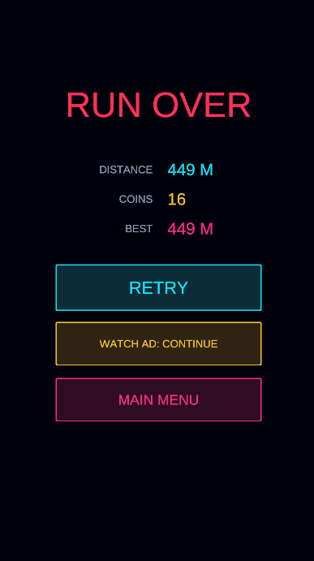 | 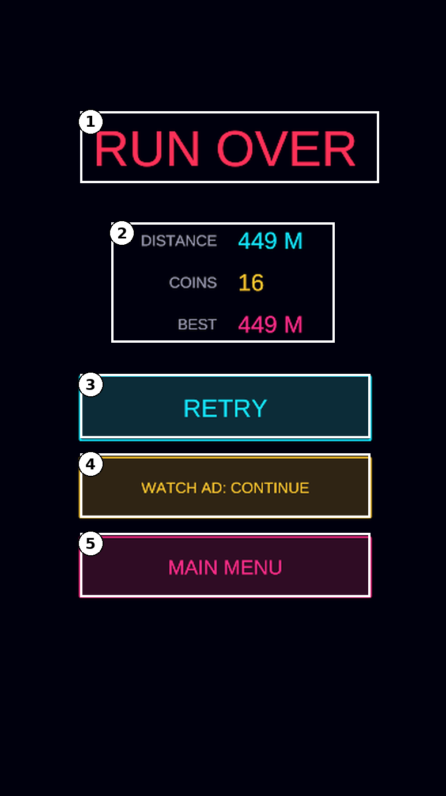 | 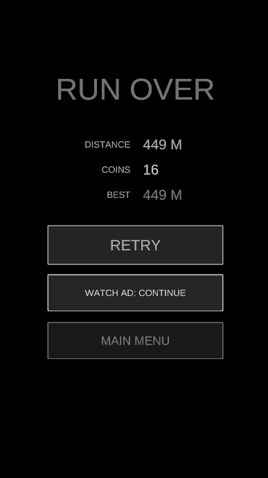 |

**Annotations**
1. **RUN OVER.** Large Red title, the standard colour for failure; it is the biggest element.
2. **Stats block.** Right-aligned labels (Grey) and left-aligned values (coloured by meaning: distance Cyan, coins Gold, best Pink), forming a clean two-column read.
3. **RETRY.** The largest button (160 px), Cyan: the encouraged action.
4. **WATCH AD: CONTINUE.** Gold, because it is reward-related, and slightly smaller.
5. **MAIN MENU.** Pink, last position, the "exit" action.

**Principles and techniques:** emotional colour (Red for failure), hierarchy of actions (size and order), alignment on a central axis for the stats, grouping of stats separately from actions, a low-friction retry loop.

**Tweens / ease:** `ButtonFeedback` on all buttons. Enters with the forward slide + fade (0.35 s, ease-in-out).

**Greyscale check:** `RUN OVER` is Red (Y = 0.24), so it becomes a mid-dark grey, but it still stands out by size. The three stat values rely on position and labels, not on hue. No change needed.

---

## Supporting screen - Run placeholder

Not one of the 10 screens. It is a stand-in for the gameplay scene, so Pause and Results can be reached in the demo: a **II** pause button (top-right) and a **DIE (TEST)** button.

| Colour | Greyscale |
|---|---|
| 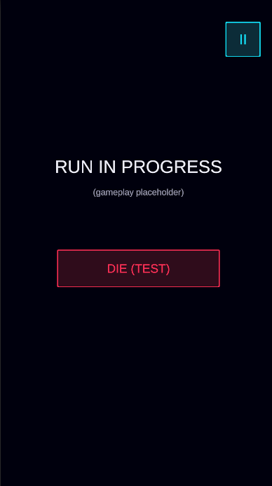 | 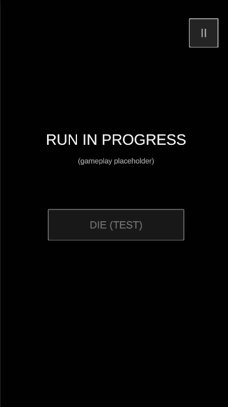 |

---

## Credits and references

**Design inspiration: [Neon Runner](https://play.google.com/store/apps/details?id=com.rego.neonrunner2026&hl=en&pli=1).** The overall visual direction was inspired by the mobile game *Neon Runner* (dark background, bordered neon buttons, Cyan / Pink / Gold accents, tab-based shop, `Completed` / `Locked` achievements, a `Run Over` results screen with Retry / Watch Ad / Main Menu). No assets from that game are used in the project. Its screenshots below are included only as a reference for comparison.

| Reference screenshot | Compare with |
|---|---|
| 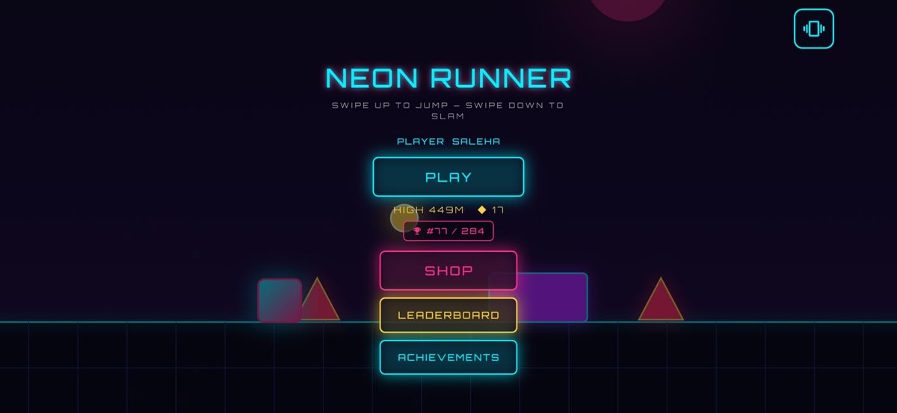 | Main Menu |
| 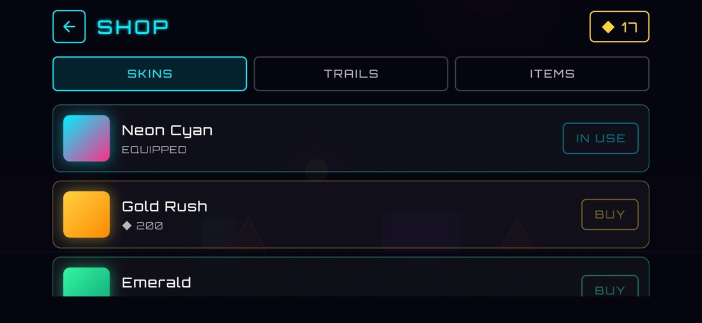 | Shop (skins) |
| 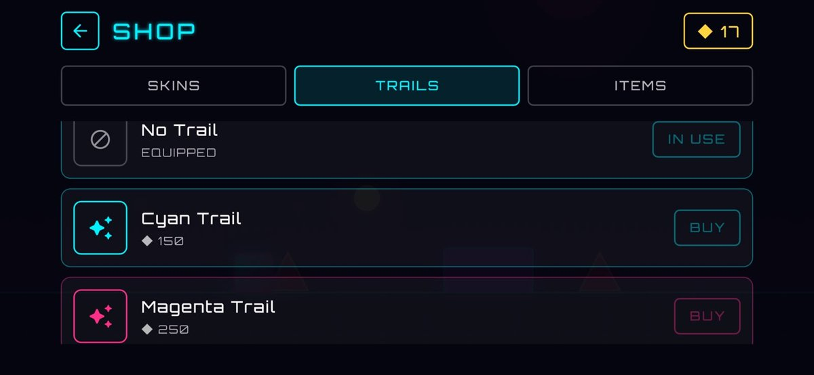 | Shop (trails) |
| 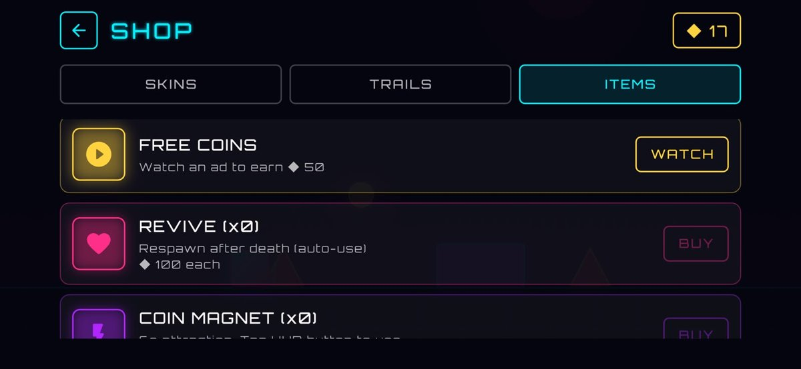 | Shop (items) |
| 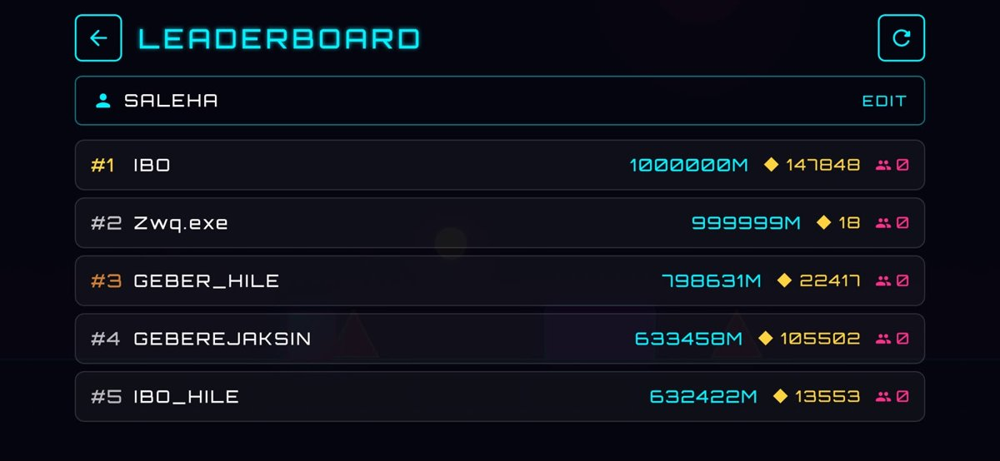 | Leaderboard |
| 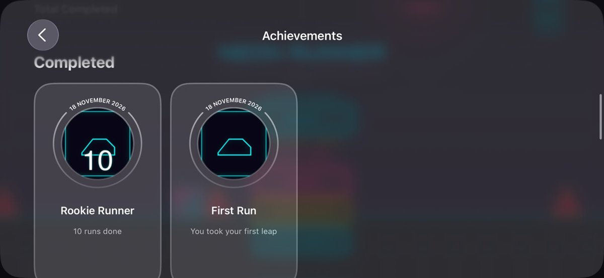 | Achievements (completed) |
| 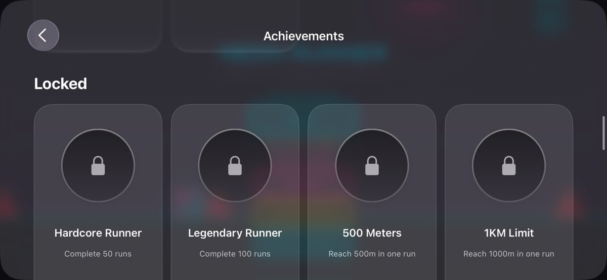 | Achievements (locked) |
| 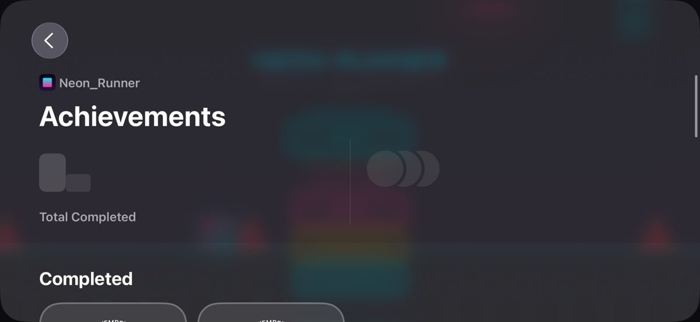 | Achievements (overview) |
| 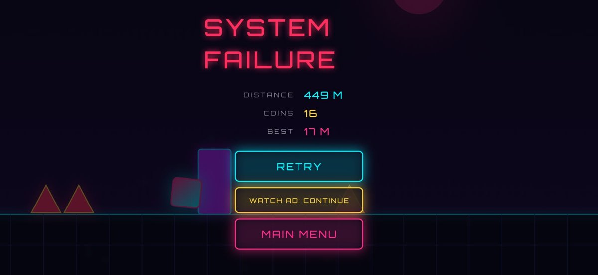 | Results |

**What I changed relative to the reference:** different game name and logo treatment, a restructured main-menu hierarchy (PLAY dominant), added Mode Select, Loadout, Settings and Pause screens, bordered boxes generated entirely in code, a different history-based navigation system, and new motion design (screen slide direction, press/release spring, cycle pop, toggle slide).